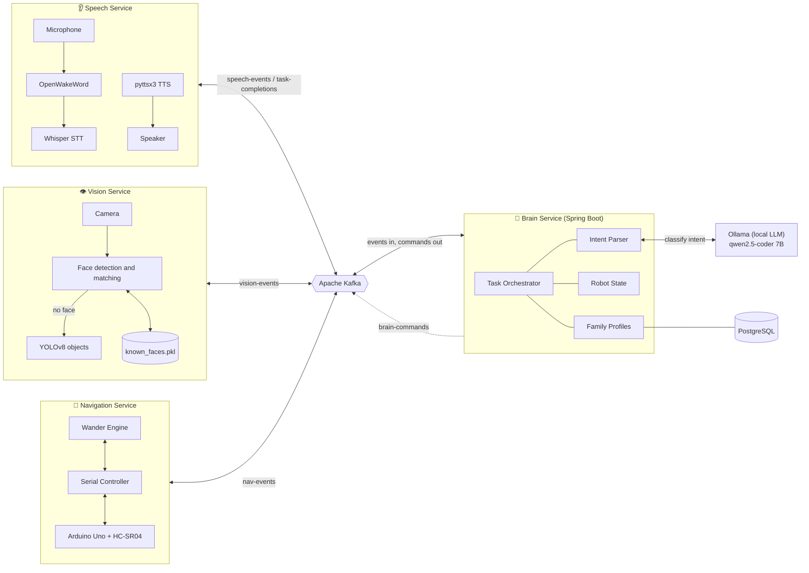
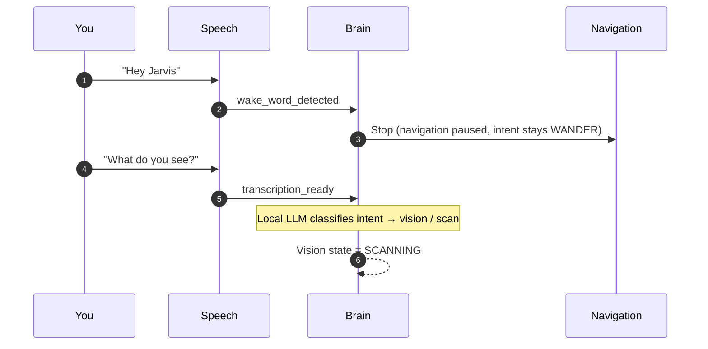
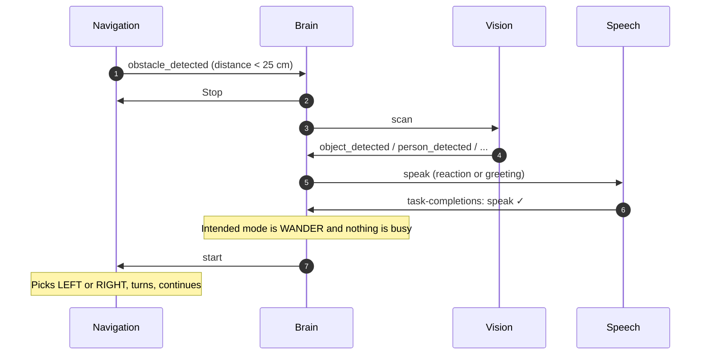
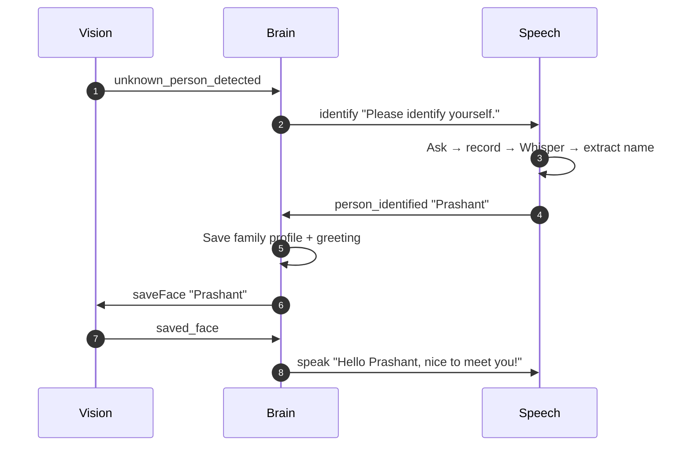
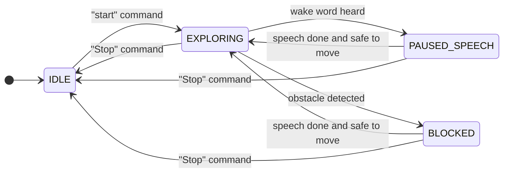

<div align="center">

# 🤖 Wanderer

### A home robot that listens, looks, remembers your name, and never stops exploring.

*Four independent services. One event stream. A robot that behaves like it has a mind of its own.*

<br>


</div>

---

## 📖 The Story

Most hobby robots are one script in one loop. They work on the desk, and they fall apart the moment you add a second feature, because everything is tangled into everything else.

I wanted to build the opposite: a robot made of **organs**, not a script.

| Organ | Job | Lives in |
|---|---|---|
| 👂 **Ears** | Wait for a wake word, hear a command, speak back | `speech_service` |
| 👁️ **Eyes** | Find faces, recognize people, name objects | `vision_service` |
| 🦿 **Legs** | Wander, sense distance, stop before it hits something | `navigation_service` |
| 🧠 **Brain** | Understand what you said (using a local LLM) and decide what every organ does next | `brain` |

None of the organs know the others exist. The ears have no idea there is a camera. The legs don't know what a face is. They only know how to publish what they *perceive* and obey what they are *told*. Everything between them goes through **Apache Kafka**, and the only one who understands the whole picture is the Brain.

That separation is the point of the project. You can unplug the camera, restart the speech service mid-sentence, or rewrite the navigation in another language, and the rest keeps running. Each service was built, run and tested on its own before I connected them.

> **The result:** a robot that wanders around a room, stops when you say its name, stops by itself when something blocks the way, looks at what it found, greets you if it knows you, asks who you are if it doesn't, remembers you for next time, and then goes back to exploring, all without a human in the loop.

---

## 🎬 A Day in the Life

> The robot is wandering across the living room.
>
> **You:** *"Hey Jarvis…"*
> The ears hear the wake word. The Brain pauses the legs at once so the motors don't drown out your voice.
>
> **You:** *"…what do you see?"*
> Speech is transcribed, the Brain understands the intent, and the eyes open.
>
> The camera finds a face it has never seen.
> **Robot:** *"I see someone I don't recognize. Please identify yourself."*
>
> **You:** *"I'm Prashant."*
> The Brain stores the name, tells the eyes to memorize the face, and the robot answers *"Hello Prashant, nice to meet you!"*
>
> Next time it sees you, it greets you by name without asking.
> The greeting finishes, the Brain checks that nothing is still busy, and the robot goes back to wandering.

Nobody told the legs to resume. The Brain remembered that the robot's *intended mode* was **wander**, and put it back there.

---

## 🏗️ System Architecture



### The one rule that makes it work

> **Services publish *events* about what happened. The Brain publishes *commands* about what to do. Nobody else talks.**

Every service listens to a single commands topic and filters by a `target` field, so each message is addressed to exactly one organ.

### Kafka topics

| Topic | Direction | Carries |
|---|---|---|
| `brain-commands` | Brain → all services | Commands addressed by `target`: `speech`, `vision`, `navigation` |
| `speech-events` | Speech → Brain | `wake_word_detected`, `transcription_ready`, `person_identified` |
| `vision-events` | Vision → Brain | `person_detected`, `unknown_person_detected`, `object_detected`, `saved_face`, `no_face_detected` |
| `nav-events` | Navigation → Brain | `obstacle_detected` |
| `task-completions` | Speech → Brain | `{ "task": "speak", "status": "success" }` |

### One command format for everything

```json
{
  "target": "speech",
  "command": "speak",
  "text": "Hello Prashant, nice to meet you!"
}
```

---

## 🔄 How Data Flows

### 1. The robot hears you



### 2. The robot meets an obstacle



### 3. The robot meets a stranger



---

## 🧠 The Brain's Mind

The Brain doesn't just react. It tracks four separate states, plus one thing the others don't have: **what the robot is supposed to be doing**.



| State machine | Values |
|---|---|
| **Navigation** | `IDLE` · `EXPLORING` · `PAUSED_SPEECH` · `BLOCKED` |
| **Speech** | `IDLE` · `LISTENING` · `THINKING` · `SPEAKING` · `ERROR` |
| **Vision** | `IDLE` · `SCANNING` · `SAVING` |
| **Intended mode** | `IDLE` · `WANDER` |

**Intended mode** is what gives the robot manners. When you interrupt it, the *current* state changes to `PAUSED_SPEECH`, but the *intended* mode stays `WANDER`. When the conversation ends, the Brain looks at the gap between where the robot is and where it was supposed to be, and closes it, but only when `isSafeToMove()` confirms that speech and vision are both idle.

---

## 🧩 The Four Services

<details>
<summary><b>🧠 Brain Service</b>: Spring Boot, the orchestrator</summary>

<br>

**Stack:** Spring Boot · Spring Kafka · Ollama (`qwen2.5-coder:7b-instruct`) · PostgreSQL · Docker

- Consumes `speech-events`, `vision-events`, `nav-events`, `task-completions`.
- Publishes commands to `brain-commands`.
- `TaskOrchestratorService` is the single place where events become decisions.
- Sends each transcription to a **locally hosted LLM** through Ollama, which classifies it into one of three intents: `speech`, `navigation`, `vision`. No cloud API is involved.
- Keeps family profiles and generates personalized greetings and object reactions.
- Owns the robot's state and the intended mode.

</details>

<details>
<summary><b>👂 Speech Service</b>: wake word, Whisper, text-to-speech</summary>

<br>

**Stack:** FastAPI · Uvicorn · OpenWakeWord + ONNX Runtime · OpenAI Whisper · SoundDevice / PortAudio · pyttsx3 · confluent-kafka

- Continuously listens for the wake word `hey_jarvis`.
- Records the command, transcribes it with Whisper, publishes `transcription_ready`.
- `speak`: says the given text and reports `task-completions` with `success` or `failure`.
- `identify`: stops the wake-word listener, asks the question aloud, records the answer, extracts a name, publishes `person_identified`, then restarts the listener.
- Three background threads: audio pipeline, Kafka consumer, TTS worker.
- HTTP: `GET /health`, `POST /speak/test?text=Hello`

</details>

<details>
<summary><b>👁️ Vision Service</b>: faces, memory, objects</summary>

<br>

**Stack:** FastAPI · OpenCV · face-recognition / dlib · NumPy · Ultralytics YOLOv8 (`yolov8n.pt`) · confluent-kafka

On a `scan` command:

1. Capture a camera frame.
2. Look for a face. If one is found, match it against `known_faces.pkl`.
3. Known face → `person_detected`. Unknown face → `unknown_person_detected`.
4. No face → run YOLOv8 → `object_detected`, or `no_face_detected` if nothing is found.

On `saveFace`, the most recent unknown face embedding is stored under the given name, and `saved_face` is published.

HTTP: `GET /health`, `POST /scan/manual`

</details>

<details>
<summary><b>🦿 Navigation Service</b>: wander engine and the Arduino link</summary>

<br>

**Stack:** FastAPI · Uvicorn · PySerial · confluent-kafka · Docker

- Talks to an Arduino Uno over serial (`COM5`, `115200` baud).
- A background thread sends `PING` and receives `DIST:<cm>` from the HC-SR04 ultrasonic sensor.
- When the robot is moving and the distance drops below the threshold (default **25 cm**), it sends `STOP` and publishes **exactly one** `obstacle_detected` event.
- Obstacle events are suppressed while the robot is deliberately stopped.
- After a stop or obstacle, a restart chooses `LEFT` or `RIGHT`, turns, and continues exploring.

| Brain command | Effect |
|---|---|
| `start` / `START_WANDER` | Begin or restart wandering |
| `Stop` / `PAUSE_WANDER` | Stop motors and pause the engine |
| `RESUME_WANDER` | Re-check distance, continue if clear |
| `ROTATE_LEFT` / `ROTATE_RIGHT` | Short timed turn, then `STOP` |

| Arduino command | Purpose |
|---|---|
| `PING` → `DIST:34.25` | Read the distance sensor |
| `FWD:140` / `BWD:140` | Drive forward / backward |
| `LEFT:120` / `RIGHT:120` | Turn |
| `STOP` | Stop the motors |
| `SERVO_PAN:<a>` · `SERVO_ARM_L:<a>` · `SERVO_ARM_R:<a>` | Servo test commands |

HTTP: `GET /health` · `GET /status` · `POST /wander/start` · `POST /wander/stop` · `POST /motor/test` · `POST /servo/test`

Settings live in `.env`:

```env
OBSTACLE_THRESHOLD_CM=25
```

</details>

---

## 🧰 Tech Stack

| Layer | Technology |
|---|---|
| **Brain** | Spring Boot, Spring Kafka, PostgreSQL |
| **Intent understanding** | Ollama running `qwen2.5-coder:7b-instruct` locally |
| **Messaging** | Apache Kafka 3.8 (KRaft mode, no ZooKeeper) |
| **Speech** | OpenWakeWord, OpenAI Whisper, pyttsx3, SoundDevice |
| **Vision** | OpenCV, face-recognition / dlib, YOLOv8 |
| **Navigation** | PySerial, Arduino Uno, HC-SR04 |
| **Service APIs** | FastAPI, Uvicorn |
| **Packaging** | Docker, Docker Compose |

---

## ✅ What It Does

- 🎙️ Hands-free wake-word activation and natural-language commands, understood by a **local LLM** (no cloud, no API keys)
- 🗣️ Speaks naturally through text-to-speech
- 🧑 Recognizes known people and greets them by name
- ➕ Learns new people through conversation, with no manual enrollment
- 📦 Identifies objects when no face is in view, and reacts to them
- 🚧 Detects obstacles and hands control to the Brain
- ⏯️ Pauses and resumes wandering on its own, based on what the robot is supposed to be doing
- 🔌 Every service runs, restarts and is testable on its own through HTTP endpoints

## 🚫 What It Doesn't Do (Yet)

I'd rather be clear about the limits.

- **No mapping or path planning.** Wandering is reactive: go forward, stop at obstacles, turn, continue.
- **No verified physical motion.** See the next section.
- **Single sensor.** One forward-facing ultrasonic sensor, so it can't see what is beside or behind it.
- **Open-loop turning.** Turns are timed (about 0.6 s), not measured with encoders or a gyro.
- **No multi-user conversation.** One speaker at a time.
- **Hardware passthrough needs Linux.** Docker Desktop on Windows or macOS can't give containers a microphone, camera or serial port. On a Linux host (such as a Raspberry Pi) the whole robot runs in containers.
- **No self-recovery watchdog.** If an event is lost mid-flow, a state can wait for an event that never arrives.

---

## 🔧 An Honest Note About the Legs

Everything in this repository was tested end to end on real hardware: the wake word, speech recognition, text-to-speech, face recognition, object detection, obstacle detection, the Kafka event flow and the Brain's decisions.

**One thing was not:** the wheels turning.

While building the motor circuit, both of my motor drivers burned out. The software side of movement is complete. The navigation service sends the correct `FWD`, `BWD`, `LEFT`, `RIGHT` and `STOP` commands over serial, and I confirmed them on the Arduino side, but I never got to watch the robot physically drive.

I'm leaving it that way on purpose. It is a clean, well-defined place for someone to pick this up:

- Wire up a motor driver (L298N, TB6612, or whatever you have) on the Arduino sketch's motor pins.
- Calibrate turn timing for your chassis.
- Tune the `140` / `120` speed values.
- Add encoders or an IMU for closed-loop turns.

Everything above the motors is ready for you.

> **If you build a motor stage:** test with the wheels lifted off the ground, power the motors from a separate supply with a common ground to the Arduino, and check the driver's current rating before connecting the motors.

---

## 🚀 Getting Started

### What you need

- **Docker Desktop** (or Docker Engine on Linux)
- **Ollama** installed on the host machine
- **Python 3.14** for the robot services if you run them natively
- A microphone, a speaker, a camera, and an Arduino Uno with an HC-SR04 flashed with the serial protocol above

### Project layout

```text
robo_software/
├── docker-compose.yml      # Kafka, topics, PostgreSQL, Brain (+ robot services on Linux)
├── .env                    # copy of env.example
├── brain/                  # Spring Boot orchestrator
├── speech_service/
├── vision_service/
└── navigation_service/
```

### 1. Start the local LLM

```bash
ollama pull qwen2.5-coder:7b-instruct   # first time only
ollama serve
```

The Brain container reaches Ollama through `host.docker.internal:11434`.

### 2. Start everything with one command

```bash
cp env.example .env              # Windows: copy env.example .env
docker compose up --build
```

| Container | What it does | Port |
|---|---|---|
| `kafka` | Message bus (KRaft, one node) | `9092` for the host, `kafka:29092` between containers |
| `kafka-init` | Creates all five topics, then exits | none |
| `postgres` | Brain's database | `5432` |
| `brain` | Spring Boot orchestrator | `8080` |
| `speech` | Wake word, Whisper, text-to-speech | `8003` |
| `vision` | Faces and objects | `8001` |
| `navigation` | Wander engine and Arduino link | `8000` |

### 3. Connect the hardware

Containers can only reach the microphone, speaker, camera and Arduino on a **Linux host** (Ubuntu, Raspberry Pi OS). There, add the hardware override:

```bash
docker compose -f docker-compose.yml -f docker-compose.linux.yml up --build
```

On Windows or macOS, Docker Desktop can't pass those devices into containers. Run `speech_service`, `vision_service` and `navigation_service` natively instead (`python main.py` in each, with their own `.env` pointing at `localhost:9092`), and let Docker run the rest.

### Services at a glance

| Service | Port | Kafka consumer group |
|---|---|---|
| Brain | `8080` | `brain-service-group` |
| Navigation | `8000` | `navigation-service` |
| Vision | `8001` | `vision-service` |
| Speech | `8003` | `speech-service` |

> Every service has its **own consumer group**, so each one receives every command on `brain-commands` and keeps only the ones addressed to its `target`.

### Key settings

| Setting | Service | Default | Meaning |
|---|---|---|---|
| `WAKE_WORD_MODEL` | Speech | `hey_jarvis` | Wake word |
| `WAKE_WORD_THRESHOLD` | Speech | `0.35` | Detection sensitivity |
| `TRANSCRIPTION_MODEL_SIZE` | Speech | `base` | Whisper model size |
| `COMMAND_DURATION_SECONDS` | Speech | `30` | Max recording time for a command |
| `IDENTIFICATION_DURATION_SECONDS` | Speech | `15` | Max recording time for a name |
| `CAMERA_INDEX` | Vision | `0` | Which camera to open |
| `OBSTACLE_THRESHOLD_CM` | Navigation | `25` | Distance that triggers a stop |
| `ai.model` | Brain | `qwen2.5-coder:7b-instruct` | Model used for intent classification |

### Try each organ alone

| Test | Call |
|---|---|
| Speech works? | `POST http://localhost:8003/speak/test?text=Hello` |
| Vision works? | `POST http://localhost:8001/scan/manual` |
| Sensor works? | `GET http://localhost:8000/status` |
| Motor command reaches Arduino? | `POST http://localhost:8000/motor/test` |
| Service alive? | `GET /health` on any of them |

---

## 🗺️ Where This Could Go

- [ ] Verify and tune physical movement (the open door above)
- [ ] State watchdog with timeouts to recover from lost events
- [ ] Cooldown on repeated "I don't see anyone" announcements
- [ ] Encoder or IMU-based turning
- [ ] More distance sensors for side and rear awareness
- [ ] Servo arms and pan head, using the existing servo commands
- [ ] Richer conversation beyond single-turn commands
- [ ] Run the full stack in containers on a Raspberry Pi

---

## 💡 What I Learned

- **Decoupling pays off.** Debugging one service at a time was possible only because no service depends on another's internals.
- **An event stream is a good contract.** Adding a fifth organ means adding a topic, not rewriting four services.
- **Robots need manners, not just logic.** Pausing for a person and resuming afterward took a dedicated state. It didn't come for free.
- **Hardware is the final boss.** Software failed gracefully. Two motor drivers did not.

---

<div align="center">

**Built by Prashant** · from a wake word to a wandering robot

*If you pick up the legs, I'd love to see it move.* 🛞

</div>
